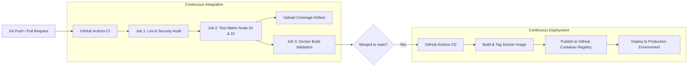

# 🚀 CI/CD Practice Lab: A to Z Guide for Beginners

Welcome to your hands-on CI/CD practice project! This repository contains a production-style, beginner-friendly pipeline using **Node.js**, **Express**, **Jest**, **Docker**, and **GitHub Actions**.

---

## 📖 Table of Contents
1. [What is CI/CD?](#-what-is-cicd)
2. [Architecture of this Pipeline](#-architecture-of-this-pipeline)
3. [Project Structure](#-project-structure)
4. [Step 1: Test the Pipeline Locally](#step-1-test-the-pipeline-locally)
5. [Step 2: Connect to GitHub](#step-2-connect-to-github)
6. [Step 3: Watch Your First CI Pipeline Run](#step-3-watch-your-first-ci-pipeline-run)
7. [Step 4: Hands-on Lab 1 — The Failing CI Test (Red to Green)](#step-4-hands-on-lab-1--the-failing-ci-test)
8. [Step 5: Hands-on Lab 2 — Continuous Deployment (CD in Action)](#step-5-hands-on-lab-2--continuous-deployment)
9. [Key Terms Cheat Sheet](#-key-terms-cheat-sheet)

---

## 💡 What is CI/CD?

* **CI (Continuous Integration)**: Automatically building, linting, and testing code whenever developers commit or open a Pull Request. It prevents broken code from reaching the main branch.
* **CD (Continuous Delivery / Deployment)**: Automatically packaging, containerizing (Docker), and releasing or deploying the verified software to staging/production environments.

---

## 🛠 Architecture of this Pipeline



---

## 📂 Project Structure

```text
CI-CD/
├── .github/
│   └── workflows/
│       ├── ci.yml            # CI: Linting, Security Audit, Matrix Testing, Docker Check
│       └── cd.yml            # CD: Push Docker image to GHCR & Deploy to Production
├── src/
│   ├── app.js               # Express application routes & logic
│   └── server.js            # Entrypoint listener
├── tests/
│   └── app.test.js          # Unit & Integration tests (Supertest + Jest)
├── scripts/
│   └── local-ci.ps1         # Local simulation runner
├── Dockerfile               # Multi-stage production container
├── .dockerignore
├── eslint.config.mjs        # Linter rules
├── package.json
└── README.md
```

---

## Step 1: Test the Pipeline Locally

Before pushing code to GitHub, professional teams run tests locally. You can simulate the entire CI pipeline right now in your terminal:

```powershell
npm run ci:local
```

Or run individual commands:
```powershell
# Run code linter
npm run lint

# Run automated tests with code coverage
npm run test:coverage

# Start the app locally
npm start
# Health check: http://localhost:3000/health
```

---

## Step 2: Connect to GitHub

To watch GitHub Actions execute in the cloud:

1. Go to [GitHub.com](https://github.com) and click **New Repository**.
2. Name it (e.g. `cicd-practice`).
3. Set it to **Public** (recommended for free unlimited GitHub Actions runners and container registry storage).
4. Do **not** initialize with README or .gitignore (we already built them).
5. In your local terminal, link and push:

```powershell
git add .
git commit -m "feat: complete initial CI/CD pipeline setup"
git remote add origin https://github.com/<YOUR-USERNAME>/cicd-practice.git
git push -u origin main
```

---

## Step 3: Watch Your First CI Pipeline Run

1. Open your repository on GitHub in your browser.
2. Click on the **Actions** tab at the top.
3. You will see two workflows running:
   - **Continuous Integration (CI)**: Checks your code quality, runs tests across Node 20 and Node 22, and verifies the Docker build.
   - **Continuous Deployment (CD)**: Builds the container and deploys to the `production` environment!
4. Click on the workflow run to see live logs of each step.

---

## Step 4: Hands-on Lab 1 — The Failing CI Test

The best way to understand CI is to watch it catch a bug before it breaks production!

### 1. Create a feature branch:
```powershell
git checkout -b feature/broken-calc
```

### 2. Introduce a bug in `src/app.js`:
Change line 28 (the add operation) from:
```javascript
result = a + b;
```
to:
```javascript
result = a - b; // BUG!
```

### 3. Commit and push the branch:
```powershell
git commit -am "test: introducing intentional bug"
git push -u origin feature/broken-calc
```

### 4. Create a Pull Request on GitHub:
- Open a Pull Request from `feature/broken-calc` into `main`.
- Notice how GitHub Actions **blocks** the pull request because `Stage 2: Test on Node` failed!
- Click **Details** to see the exact failing test.

### 5. Fix the bug:
- Revert the bug in `src/app.js` back to `result = a + b;`.
- Commit and push again.
- GitHub Actions automatically re-tests the PR and turns **Green** ✅.

---

## Step 5: Hands-on Lab 2 — Continuous Deployment

Now that the tests pass:

1. Click **Merge pull request** on GitHub.
2. Because new code landed on `main`, the **CD Workflow** automatically triggers!
3. Go to the **Actions** tab -> select **Continuous Deployment (CD)**.
4. You will see:
   - Container image built and pushed to **GitHub Packages** (GHCR).
   - Deployment registered under the **Environments -> production** section of your GitHub repo!

---

## 📚 Key Terms Cheat Sheet

| Term | Definition |
| :--- | :--- |
| **Workflow** | An automated configurable process made up of one or more jobs (defined in `.github/workflows/*.yml`). |
| **Trigger (`on`)** | The event that starts the workflow (e.g. `push`, `pull_request`, `workflow_dispatch`). |
| **Runner** | A cloud VM (e.g. `ubuntu-latest`) provided by GitHub that executes your commands. |
| **Matrix Build** | Running the same tests across multiple environments (e.g. Node 20.x and 22.x simultaneously). |
| **Artifact** | Files generated during a build (like test coverage HTML, build bundles, or log files) saved for inspection. |
| **GHCR** | GitHub Container Registry — stores and serves Docker container images. |
